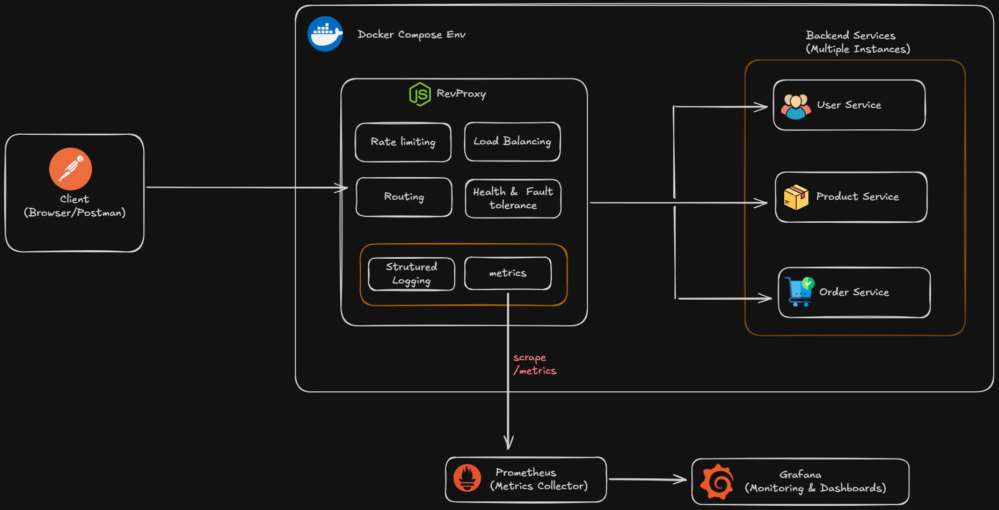

# revproxy

revproxy is a lightweight reverse proxy and load balancer developed using JavaScript and Node.js core modules. The goal of this project is to understand how reverse proxies work internally by implementing essential networking, routing, load balancing, fault-tolerance, and security mechanisms without relying on existing proxy frameworks or libraries.

# Architecture



## Features

### 1. Reverse Proxy
- Forwards HTTP requests, methods, headers, paths, and responses between clients and backend services.
- Streams request and response bodies while handling upstream failures.

### 2. Connection Management
- Uses backpressure-aware streams and keep-alive connections.
- Handles timeouts, client disconnects, and graceful shutdown.

### 3. Dynamic Routing
- Routes requests by URL prefix and rewrites paths for User, Product, and Order services.
- Maintains backend addresses and instance details in a service registry.

### 4. Load Balancing
- Distributes requests using round-robin and weighted round-robin strategies.
- Supports least-connections routing across eligible backend instances.

### 5. Health Checks and Fault Tolerance
- Health checks track backend availability and exclude unhealthy instances.
- Circuit breakers and failure tracking help prevent repeated failed requests.

### 6. Security
- Supports bearer-token authentication, IP filtering, and rate limiting.
- Enforces a 5 MB request-body limit and filters hop-by-hop headers.

### 7. Observability
- Provides `/health`, Prometheus metrics at `/metrics`, and request IDs.
- Logs request status, client addresses, and request durations.

### 8. Docker
- Docker Compose starts the proxy, backend instances, Prometheus, and Grafana.
- Backend instances use `BACKEND_HOST=backend` in Compose.

## Tech Stack

- **Runtime:** Node.js
- **Language:** JavaScript (CommonJS)
- **Networking:** Node.js HTTP and streams
- **Dependencies:** `dotenv`, `prom-client`
- **Monitoring:** Prometheus and Grafana
- **Containerization:** Docker 
- **Patterns:** Reverse proxy, service registry, load balancing, circuit breaker

## Run with Docker Compose

```sh
docker compose up --build
```

The proxy listens on `http://localhost:8080`, Prometheus on `http://localhost:9090`, and Grafana on `http://localhost:3000`.

## Project Structure

```text
revproxy/
├── src/
│   ├── backend/
│   ├── proxy/
│   ├── router/
│   ├── registry/
│   ├── config/
│   ├── loadbalancer/
│   ├── health/
│   ├── observability/
│   └── middleware/
├── monitoring/
└── package.json
```
